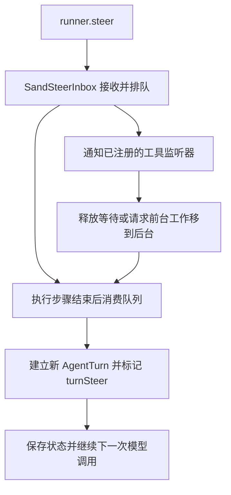

# 扩大范围调查：部署线索与用户消息控制链

日期：2026-10-12。此次在已取得的主程序和评估 runner 上继续追踪，并扩大远端检查范围。

## 本次取得的结果

新增 15 个静态文件，包含系统启动脚本、监督与更新模块、三个辅助 Worker、依赖清单。此前只看到步骤边界注入的入口；现在已经连到排队消息的实际消费、新 turn 的建立、等待释放及前台工作移到后台的代码。

已发现“程序提供某种能力”与“当前调用路径已开启这种能力”的重要区别：空闲模型采样抢占需要额外策略，MCP 提前释放需要显式启用，而且有工具注解限制。

## 扩大的部署查找范围

检查了 `/opt`、`/exec-daemon`、`/cursor`、全局依赖、系统服务配置、安装缓存和守护进程发布目录。文件名调查覆盖 7,245 个目录和 36,415 个文件名；这是有排除项和深度限制的目录调查，没有读取这些文件的全部内容。

另一轮静态清单记录到 97 个代码或名称候选文件，未发现 sourcemap；11 个名称候选主要是 PDF、diff、数据存储、搜索或评估用途。对 86 个选定的一方静态文本文件检查 Temporal SDK、Worker 启动及 task queue 相关标记，未找到对应入口。检查的几个基础服务及 orbitd bundled 二进制也未匹配所选 Temporal SDK 标记。

具体范围和数量见 [deployment-scope.json](analysis/deployment-scope.json)。这些负面结果支持“已检查的部署材料中尚未取得云端 Worker”的判断，不能证明所有语言、改名、被剥离符号或动态加载的实现都不存在。

后续 SSH 出现 banner 握手超时；当时跳板机 2222 端口仍在监听。当前使用的 orbitd 更新版本二进制没有完成检查，不能将 bundled 版本的结果替代为当前版本的结果。

## 用户消息进入云端后的边界

[`sendPrompt` 的实际 RPC 代码](excerpts/deep-host-680191-cloud-send-boundary.txt) 把新消息传给 `sendGrokBotUserMessage()`，然后根据 delivery 处理接受、重复或拒绝。请求没有选择 `steer / queue / interrupt` 的字段；响应协议另有 dispatched、mode 和 workflow_id 字段。

[静态协议字段](analysis/cloud-routing-protocol.json) 说明云端负责返回路由/派发结果；当前客户端调用没有给出云端内部如何处理活动运行的代码。不能把 RPC 被接受直接解释成“已经注入模型上下文”或“已经中断当前工具”。

## 找到的 Worker 分工

`agent-isolation/agent-store-worker.cjs` 由 Node `worker_threads` 启动，处理 `set-blob`、`get-blob`、`find-latest-root`、清理、导出和关闭等存储请求。它是会话数据工作线程；[启动与通信代码](excerpts/deep-host-684893-agent-store-worker-pool.txt) 没有将它注册成 Temporal Worker。

另外两个文件分别负责内容搜索索引和 box store vacuum。启动脚本和 supervisor 模块管理本机 host、执行服务、桌面与守护进程的启动/更新；已取得部分的 host bundle 入口是 `/opt/sand/sand-host/host-main.cjs`。

文件名里出现 Worker，不能单凭名称认定其执行云端 Bot Workflow。

## 消息注入已经追到新 turn 的建立

下面描述的是收录的 in-process/shared runner 实现：



[`consumeQueuedUserMessagesAndMaybeCreateNewTurns`](excerpts/deep-eval-468200-queued-user-turns.txt) 会读取 `userMessageAction`，比较当前与排队消息的 message ID；需要新 turn 时调用 `createAgentTurn()`，并为已认领的注入设置 `turnSteer = true`。随后更新 mode，并按 checkpoint 配置保存状态。失败时已认领的注入可重新入队。

因此“注入运行中的消息”在这条实现里可以继续同一个 run loop，同时在会话状态中创建新的 user turn。新消息的方向随后影响模型下一步决策，而不是把所有已有工作自动销毁。

## 为什么等待后台工作的 Bot 能转回来响应

| 被占用的操作 | 收到消息后的动作 | 后台工作结果 |
|---|---|---|
| 前台 Shell | 通过 `force-background-shell-executor` 请求 background handoff | Shell 可以继续运行 |
| 前台子代理调用 | 通过 `force-background-subagent-executor` 请求 background handoff | 子代理可以继续运行 |
| Await 子代理 | 消息信号与等待结果进行 race，取消这次等待，返回 `stillRunning` | 没有在这条分支中停止子代理 |
| Await Shell | 提前结束等待，返回 `stillRunning`，wakeReason 为 `context_injection` | Shell 没有被该分支杀掉 |

Shell 和子代理 handoff 失败时，代码在待处理消息仍存在的条件下，使用 500 ms 重试计时器。这个数是该重试机制的间隔，不是线上用户响应时延保证。

证据：[Shell handoff](excerpts/deep-eval-485142-shell-background-handoff.txt)、[子代理 handoff](excerpts/deep-eval-476320-subagent-background-handoff.txt)、[Await 释放](excerpts/deep-eval-479192-await-release.txt)。

## 抢占能力的开启条件

### 模型采样

[`IdleModelSamplePreempter`](excerpts/deep-eval-458711-idle-preemption.txt) 仅在 signal 带有 `idleModelSamplePreemption` policy、且 graceMs 非负时建立。它把 reasoning 与还未输出视为可抢占阶段；出现文本或 tool-call 输出后会解除该抢占计时器。

收录的 `SandSteerInbox.receiver()` 仅提供消息存在检测和 admission listener，没有提供上述 policy。两个 bundle 中该 policy 字段的引用都只出现在消费侧。因此可以确认共享执行器具备此能力，不能据此宣称这个默认 inbox 已启用“收到用户消息立即打断模型思考”。外部调用方是否添加策略尚待核实。

### MCP 调用

[`CallMcpTool`](excerpts/deep-eval-446569-mcp-steer-release.txt) 的 `steerReleaseReadOnlyTools` 默认 false。开启后，仍要求工具注解 `readOnlyHint === true`，并取得消息注入 signal，才进入提前释放分支。

该分支默认最少运行 5,000 ms 后允许释放，取消后等待收尾的 drain 时间为 1,500 ms；这些是函数默认参数，可以由调用方修改。没有找到此评估 bundle 内将 `steerReleaseReadOnlyTools` 设为 true 的调用点，host bundle 中也没有这一参数名。

这意味着“所有 MCP 都会立即让出给新消息”没有代码支持。提前结束等待或取消请求也不能证明外部操作已经回滚。

## 停止当前 turn、后台任务与停止远端工作

[`abortBackgroundWork()`](excerpts/deep-eval-568599-background-stop.txt) 调用 `interruptAll()`、后台 Shell 清理以及 CloudAgent watch 清理，然后等待子代理结束。

其中 `cancelCloudAgentWatches()` 的实现是清空本地 watch/settlement 集合；该方法本身没有调用远端 CloudAgent 的取消 RPC。因此清理 watch 不能作为远端任务已经停止的证据。`StopSubagent all:true` 另有 delegated-work 接口，实际停止的范围还取决于该接口是否存在、是否能到达对应服务及其返回结果。

## 对实际收件队列做了隔离验证

[steer_inbox_probe.cjs](analysis/steer_inbox_probe.cjs) 从现有 bundle 提取 `SandSteerInbox` 原实现，仅对协议数据类使用 stub。它没有启动 Bot、模型或远端工具。

验证通过的可观察行为包括：只在 live run 接收、admission 通知、FIFO、交付失败回到队首、交付确认以及 run 结束时拒绝未交付消息。结果见 [probe-result.json](analysis/steer_inbox_probe-result.json)。可在本地运行：

```sh
node analysis/steer_inbox_probe.cjs
```

这个验证覆盖收件队列本身，不覆盖线上 Workflow、真实工具取消或云端调度。

## 仍缺的核心实现

当前用户消息的云端 RPC 路由已找到；共享 runner 如何消费消息和释放工具等待也已找到。尚缺线上 Workflow 如何接收外部事件、何时选择 steer/interrupt/new run、如何安排用户与后台事件，以及部署时具体注入哪些策略的完整代码。

当前证据足以解释多种保持响应的机制，仍不足以声明已完整还原线上 Temporal 调度。
