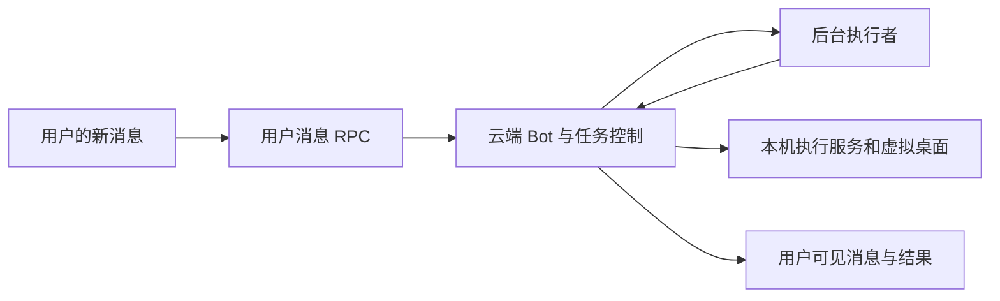

# Grok Bot：工作期间的新消息、后台任务与改变方向

调查时间：2026-10-12，北京时间。资料范围：静态程序、脚本和通用 skill；主程序版本：`7345aa4`。

通过 SSH 读取进程、配置、状态和主程序代码；没有发送测试消息、创建定时任务、停止 Bot 或修改远端配置。报告区分当前实测、包内工具契约和共享/旧实现，后两者不能直接当作云端本次会话实际启用的全部行为。

## 1. 找到了与你描述直接对应的规则

内置 `packages/grok-bot-harness/src/runner/system-prompt.ts` 中有 `UNFINISHED_TASKS_REMINDER`：

> The user interrupted your work to send you a message. Follow the new message first.

接着要求：继续完成之前未完成的任务；如果用户要求停止、取消或结束工作，则不要继续或恢复它们。[代码证据 E01](evidence.txt:1)

产品设计把“先处理新输入”和“取消旧任务”分开。补充要求、询问进度、追加任务、彻底取消，是不同情况；模型理解用户意图，再通过控制工具处理正在工作的执行者。这个提醒在包中可见，但本调查没有截取云端最终组装的提示词，因此不能断言每条新消息都会插入这个常量。

## 2. 当前机器的实际调用链

本次检查的代理配置使用 `harness: temporal`。用户身份、代理名称和配置原文件均未打包。Node 运行 `host-main.cjs`，网关在 1340，执行服务在 1337，桌面分流在 1339，另有 8 个虚拟桌面。

用户消息通过 `sendGrokBotUserMessage` RPC 提交，带有 `agentId`、`messageId/clientNonce`、会话、附件等字段。回应包含 `ACCEPTED_TEMPORAL`、`DUPLICATE` 和拒绝结果。停止当前运行则调用独立的 `interruptGrokBotAgentRun`，原因字段为 `user_interrupt`。[E16](evidence.txt:738)

`server-agent-proxy` 对 temporal 代理订阅服务端 transcript，并覆盖活动状态。[E17](evidence.txt:827) 本地 `SendPipeline.sendPrompt` 拒绝本地执行服务端代理，旧执行路径抛出 `SandBoxHarnessRetiredError`。[E18](evidence.txt:867)

据此判断，当前会话由云端 temporal 路径承接，本机提供工具执行、桌面和数据支撑。云端 worker 的实际调度源码不在本次取得的文件中。



图按当前路由和包内契约归纳，云端内部连接尚未作线上跟踪。本地网关健康状态只能说明本地 host 的状态，不能据此判断所有云端任务是否空闲。运行状态快照未打包。

## 3. 能持续对话的三层机制

### 主 Bot 保持对话可用

内置 `multitask-prompt.ts` 要求将研究、文件处理、多步命令等耗时工作交给 `executor` 子代理。主 Bot 派发后处理其他工作或结束自己的这一轮，子代理完成后再唤醒主 Bot。相关补充、修订尽量送回已有执行者，保留工作流。[E02](evidence.txt:12)

这是一项提示词要求，真正执行依赖子代理运行时。包内有 `Task` 和 `Subagent` 两种名称；子代理上下文是否从父会话继承还受 feature gate 影响，交给它的目标、上下文和完成标准仍需明确。[E03](evidence.txt:57)

### 新输入进入已有执行上下文

共享 agent 引擎提供 `contextInjectionSignal`、`hasPendingUserInjections()` 和 `onUserInjectionAdmitted()`。

步骤边界调用 `consumeQueuedUserMessagesAndMaybeCreateNewTurns()`；已认领的 injection 被取出后，消息标记为 `turnSteer = true`，追加到 transcript，再用原来的 `stateHandler` 创建新 turn。这保留已有会话状态。[E11](evidence.txt:402)

共享协议 `InjectBackgroundComposerContext` 的注释明确说明：下一处安全步骤边界交付，不取消已经在进行的工作；若碰上运行结束的竞态，则转为下一轮 follow-up；以 `injection_id` 做幂等。它属于 BackgroundComposer 协议，本次没有证实 Grok 的每条用户消息都直接经过此 RPC。[E10](evidence.txt:370)

### 长时间等待让出处理新消息的机会

- **Await 提前返回**：等待与用户输入信号竞赛；新输入到达时结束等待，返回 `stillRunning`，子任务仍可继续。[E12](evidence.txt:466) [E13](evidence.txt:514)
- **Shell / Task 前台转后台**：输入信号触发 `ForceBackgroundShellArgs` 或 `ForceBackgroundSubagentArgs`，交接同步等待；失败时可重试。[E14](evidence.txt:570)
- **模型没有可见输出时抢占采样**：`IdleModelSamplePreempter` 在有新输入且策略允许时取消当前闲置采样；可见文本或工具输出一旦开始，该项抢占就解除。宽限时间由策略提供。[E15](evidence.txt:638)

以上是包内共享实现。云端 temporal 实际启用哪些策略、哪些工具提供信号、边界延迟是多少，本次未在线验证。新消息能够释放等待，不代表已经发生的外部动作会回滚。

## 4. 配套控制工具

| 工具 | 包内契约 | 作用 |
|---|---|---|
| `Task` / `Subagent` | 启动任务，完成后用 `resume` 延续上下文 | 后台执行 |
| `MessageSubagent` | 向运行中的子代理纠正消息，保留上下文继续工作 | 改变方向 |
| `CheckSubagent` | 查询状态、运行时长和近期工具动作 | 诊断进度 |
| `StopSubagent` | 指定一个或 `all: true` 停止已委派工作 | 取消任务 |
| `TodoWrite` | 保存并核对各工作流的任务状态 | 任务账本 |
| `SendToAgent` | `priority: true` 立即唤醒，`false` 留待下次处理 | 联系其他个人 Bot |
| `WakeParent` | 结束 routine 并交接给父 Bot | 后台通知/阻塞交接 |
| `SendToUser` | 实际投递用户可见消息 | 回复和交付 |
| `CloudAgent` | 部分配置支持 `queue / steer / interrupt` | 仓库工作的云端代理 |

`MessageSubagent` 调用 `steerSubagent(id, message)`；有 detached 控制器时绑定到 `detachedSubagents.steer(...)`，否则走 host 控制器。这里看到的是接口绑定，云端 detached 实现未取得。[E04](evidence.txt:125) [E05](evidence.txt:192)

参数示意，未实际调用：

```json
{"subagent_id":"正在运行的子代理 ID","message":"用户补充：只调查新消息如何改变当前任务，其余调查暂缓。"}
```

明确停止的参数：

```json
{"all":true}
```

提示词要求收到停止指令后先停止所有已委派工作，再核对仍运行的 Shell 命令和不可达执行者；不会把一次普通补充自动解释成取消。[E02](evidence.txt:12)

`SendToAgent` 面向另一个 Bot，与用户直接输入有区别。`priority=true` 是要求接收者现在行动，`false` 只在其下一轮处理。群聊和跨环境代理另有限制；不能把 priority 当作任意消息的通用强制中断。[E06](evidence.txt:256)

`CloudAgent` 的 `queue / steer / interrupt` 模式受 `grok_bot_cloud_agent_reply_modes` gate 控制；包内默认 false，注明 temporal-only。这里只确认模式设计和 gate，没有确认账户在云端的实际开关。[E20](evidence.txt:918)

## 5. 原任务和旧结果怎样处理

`TodoWrite` 的描述将它定义为跨工作流的持久任务列表。每次用户消息或后台完成唤醒，要核对正在做什么、结果到了什么、下一步安排什么。状态有 pending、in_progress、completed、cancelled，交付后才能标 completed。[E09](evidence.txt:334)

任务账本记录“还有哪些事”；运行时消息队列决定“现在处理哪条输入”。二者作用不同。

后台完成后，主 Bot 判断结果是否过时、重复、相关、用户是否在等它，再交付。已取消或改变方向的任务结果尤其需要这一层处理。[E08](evidence.txt:325)

routine 的普通 final 可以只保存为自动化结果；需要让用户看到内容或让主 Bot 处理阻塞时，通过 `WakeParent` 交接，父 Bot 再写可见消息。后台运行与聊天投递存在明确边界。[E07](evidence.txt:302) [E21](evidence.txt:951)

## 6. 配套 skill

托管目录是 `/home/box/sand-data/managed-skills/skills/`。调查时其中 51 个直接子目录含 `SKILL.md`；另外还有插件和自定义 skill，因此 51 不是全机所有 skill 的总数。

| Skill | 与本机制的关系 | 保存的内容 |
|---|---|---|
| `routines` | 用 `UpdateRoutine` 保存 prompt + 定时/事件触发，明确结果收件人、无变化时是否静默 | [原文](installed-skills/routines.md) |
| `box-desktop` | 浏览器/桌面操作交给专门子代理 | [原文](installed-skills/box-desktop.md) |
| `code-changes` | 非简单仓库工作交给 CloudAgent，同一任务追加工作送回原代理 | [原文](installed-skills/code-changes.md) |
| `channels` | 区分外部渠道 `[inbound]` 隐藏唤醒与应用中的用户直接消息，规范回复地址 | [原文](installed-skills/channels.md) |
| `no-connector-fallback` | 连接器不可用时的执行路径选择 | [原文](installed-skills/no-connector-fallback.md) |

这 51 个托管 skill 中没有名为 multitask、steering、interrupt 的独立条目。核心能力由内置提示词、子代理工具、执行信号和云端运行时提供；skill 指导何时和怎样使用它们。要在其他系统实现同样体验，还需异步执行、消息控制和状态持久化等运行时支撑。

## 7. “用户消息优先”的证据边界

包内旧本地 `SandRunScheduler` 有三个队列，选取顺序为：

```text
pendingUser → pendingAgent → pendingBackground
```

这是明确的优先级设计证据。active 任务未结束时它不会直接启动下一个 task；另有 watchdog 逃逸逻辑。所以队列优先本身也不等于立即杀掉当前任意工具。[E19](evidence.txt:893)

**本次检查的 Bot 走 temporal，旧本地 send 路径已退役，不能把这个 scheduler 当作它们现在的云端调度器。**

已确认：对应的内置用户优先规则、后台执行者控制工具、共享注入/释放等待实现、当前用户消息的云端路由。

尚未确认：云端实际队列算法、每种新输入如何选择 steer 或新 turn、账户 feature gate 的实际值、每类 MCP 调用的中断能力，以及具体响应延迟。

## 8. 可复查文件

- [编号代码证据](evidence.txt)
- [源码模块摘录索引](excerpts/index.tsv)
- [原始静态主程序](sources/opt/sand/sand-host/host-main.cjs)
- [文件 SHA-256 清单](manifest.json)

进一步验证实际行为时，可用受控长任务配合中途修订，观察输入接收、执行者纠正、旧结果过滤和停止回执的先后顺序。本次没有进行改变现有 Bot 状态的测试。
